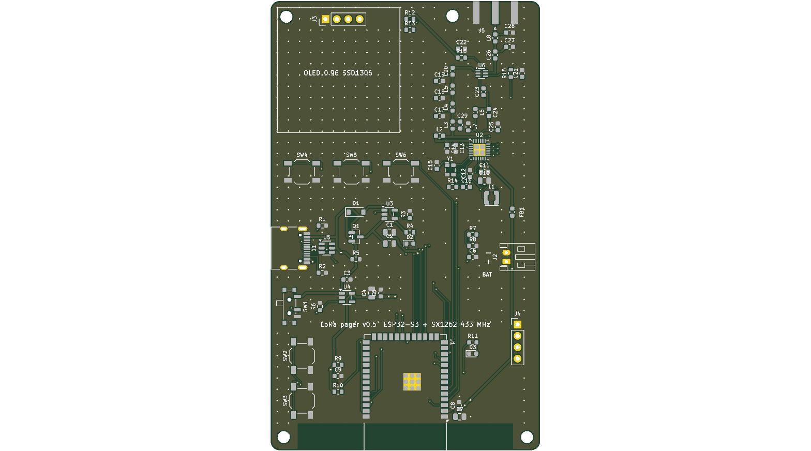
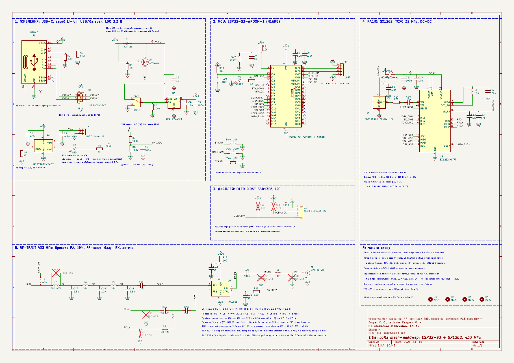

# LoRa mesh-пейджер на власній друкованій платі

Науково-дослідна робота студента групи ЕЛ-12 Батрака Святослава.
Науковий керівник — Качурак Юрій Михайлович. Національний університет «Львівська політехніка», спеціальність G5 «Електроніка».

Текстовий пейджер для зв'язку малої групи без мобільної мережі й інтернету: повідомлення передаються радіо **LoRa на 433 МГц**,
пристрої утворюють **mesh-мережу** (кожен ретранслює чужі повідомлення). Ідея близька до Meshtastic, але апаратна частина —
**власна плата**: ESP32-S3 + голий чип SX1262 з усією обв'язкою, узгодженням і фільтром.

## Стан

| Частина | Стан |
|---|---|
| Принципова схема | готова, ERC — 0 помилок |
| Друкована плата | розведена (4 шари, 60 × 100 мм), DRC — 0 помилок, плата збігається зі схемою; Gerber і файл позицій готові |
| Номінали RF-узгодження | стартові значення розраховано; остаточні — після вимірювань NanoVNA |
| Виготовлення, прошивка | ще не розпочато |

## Що де лежить

| Папка | Вміст |
|---|---|
| [`hardware/v0.5`](hardware/v0.5/README.md) | **поточна версія** плати: проєкт KiCad, PDF схеми, Gerber, BOM, рендери, скрипти |
| [`hardware/v0.4`](hardware/v0.4/README.md) | попередня версія + її [аудит](hardware/v0.4/Аудит%20плати%20v0.4.md) |
| [`hardware/v0.6-plan`](hardware/v0.6-plan/Що%20додати%20в%20плату%20(v0.6).md) | що додати в наступну версію |
| [`docs/01-tema`](docs/01-tema) | пропозиція теми, дослідження по етапах |
| [`docs/02-doslidzhennia`](docs/02-doslidzhennia) | звіт дослідження (аналоги, публікації, розрахунки), джерела, симуляція mesh-мережі |
| [`docs/03-rozrakhunky-rf`](docs/03-rozrakhunky-rf/Стартові%20номінали%20RF%20433%20МГц.md) | розрахунок стартових номіналів радіотракту на 433 МГц |
| [`docs/literatura`](docs/literatura) | список використаних джерел (ДСТУ 8302:2015) |

## Версії плати

| Версія | Що змінилось |
|---|---|
| v0.1–v0.2 | перша схема; схему перемальовано «як вручну», з'єднання звірено нетлистом |
| v0.3 | повна перевірка; виправлено переплутані виводи 4 і 6 RF-ключа PE4259 |
| v0.4 | за джерелами Semtech: режектор 2-ї гармоніки, оновлений ФНЧ, кріпильні отвори |
| **v0.5** | за аудитом: розв'язка ESP32 впритул до виводу живлення, полігон 3,3 В, окреме живлення радіо через феритову намистину, RF-траса без перехідних |
| v0.6 | план: вібромотор, захист акумулятора, роз'єм розширення (ларингофон, GPS), тестові точки |

Кожна папка версії — окремий проєкт KiCad 10: відкривати `lora-pager.kicad_pro` всередині.

## Апаратна частина (v0.5)

- **Радіо:** SX1262 (QFN-24), DC-DC 15 мкГн, TCXO 32 МГц від DIO3, RF-ключ PE4259 від DIO2.
- **RF-тракт 433 МГц:** узгодження підсилювача → ФНЧ 5-го порядку → RF-ключ → LC-балун приймача → π-узгодження антени → SMA.
- **Мікроконтролер:** модуль ESP32-S3-WROOM-1-N16R8 (16 МБ flash, 8 МБ PSRAM, Wi-Fi/BLE, USB).
- **Живлення:** USB-C → заряд Li-ion MCP73831 → автоперемикання USB/батарея → LDO AP2112K-3.3.
- **Інтерфейс:** OLED SSD1306 128×64 (I2C), 3 кнопки, світлодіоди, UART.
- **Плата:** 4 шари (In1 — суцільна земля під RF), 1,6 мм, стек JLC04161H-7628.

## Потужність передавача

Відповідно до переліку радіочастот, що не потребують дозволу (постанова НКЕК № 361 від 03.07.2024, п. 50),
у смузі 433,05–434,79 МГц — 1 мВт ЕВП або до 10 мВт ЕВП при робочому циклі < 10 %.
Плата технічно підтримує до +22 dBm; у прошивці потужність обмежується до +10 dBm.

## Інструменти

KiCad 10, Python 3 + pcbnew API (скрипти в `hardware/*/tools`), Freerouting 2.5 для некритичних цифрових трас
(радіочастина й SPI біля SX1262 розведені вручну), NanoVNA — для налаштування RF (план).
